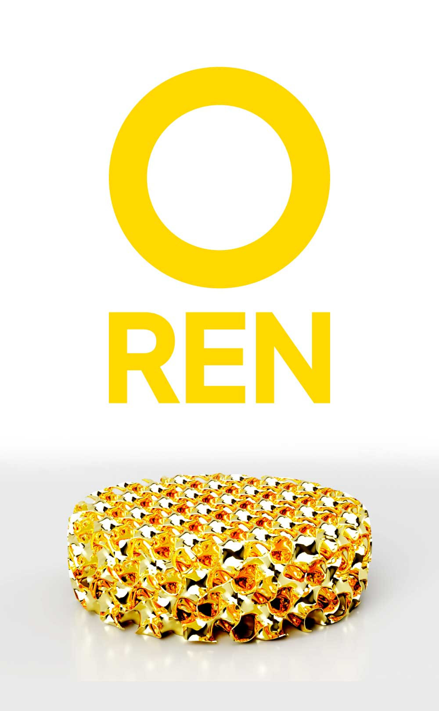
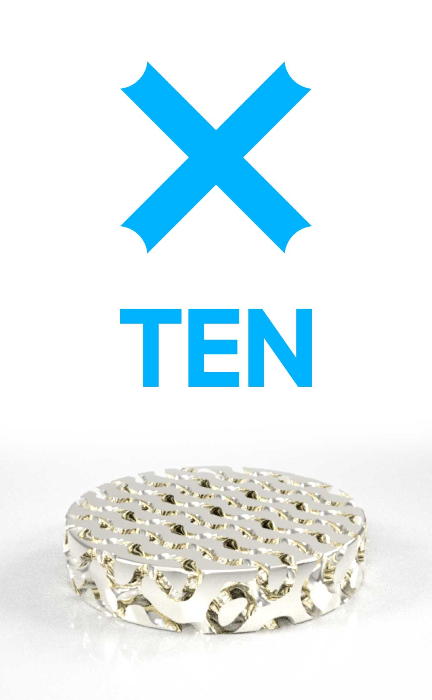
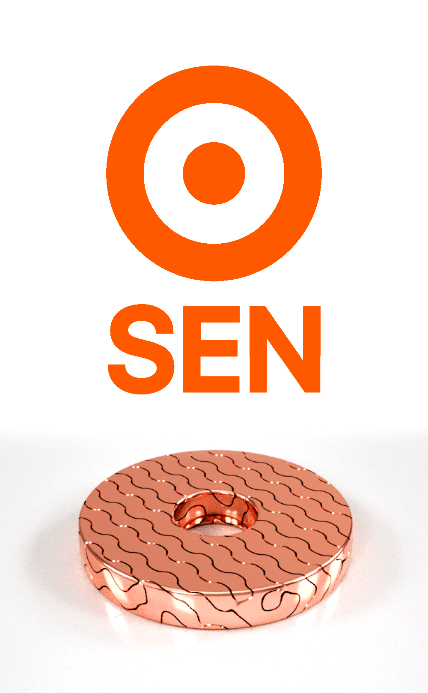
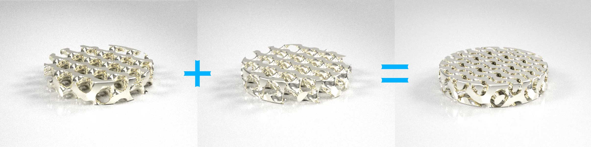
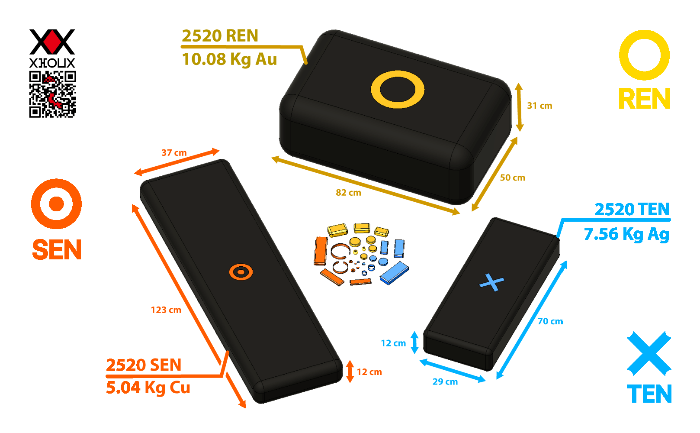
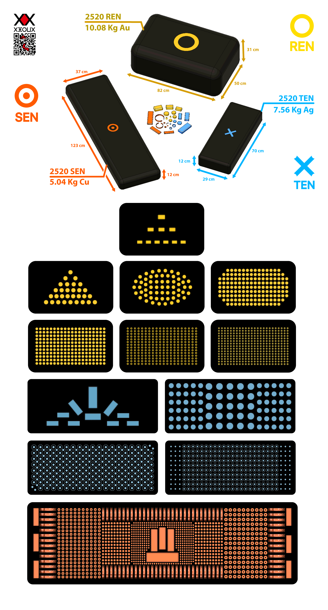
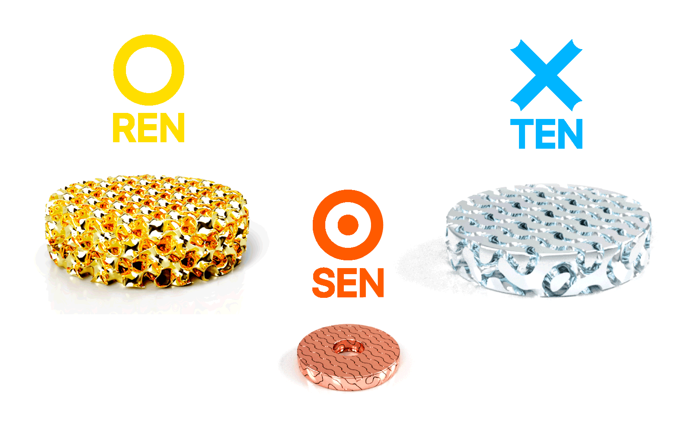
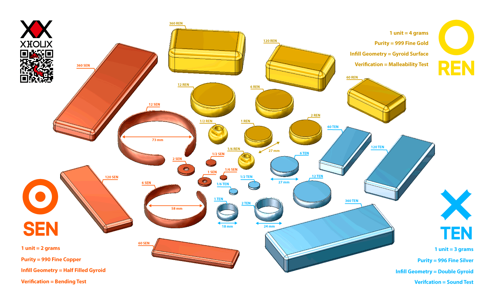

# Layer 1: Physical Coins

> **Status:** design study from 2020-2021. The models are design drawings. How to check a coin by hand (weight, size, sound) and how to make coins hard to counterfeit are open research.

## What is in this folder

| Path | Content |
|---|---|
| [`SPECS.md`](SPECS.md) | fineness, denominations, weights, fill and shape of every Ren, Ten and Sen coin |
| [`images/`](images) | renders of the coins and of the "God's Block" packing |
| [`models/all-coins.stl`](models/all-coins.stl), [`models/all-coins.iges`](models/all-coins.iges) | every coin in one 3D model (STL for printing and viewing, IGES for CAD) |
| [`models/ten-1.stl`](models/ten-1.stl) | the 1 Ten coin alone |
| [`models/ren-coins.zip`](models/ren-coins.zip), [`ten-coins.zip`](models/ten-coins.zip), [`sen-coins.zip`](models/sen-coins.zip) | one STL per denomination (nine each: 1/6, 1/2, 1, 2, 6, 12, 60, 120, 360) |

**How to look at the models:** GitHub shows `.stl` files in the browser. On your machine, open them in any slicer or viewer (PrusaSlicer, Cura, MeshLab, Blender, FreeCAD). The zip archives name the fractional coins `1:6` and `1:2`; Windows cannot store a colon in a file name, so unzip them on macOS or Linux, or rename while extracting.

**How to review:** check the numbers in [`SPECS.md`](SPECS.md) (weight = denomination x 4 g, 3 g or 2 g), measure the models' volumes against the stated weights and fills, and tell us whether the shapes are printable in metal. Ideas for verification by hand and against counterfeits are the most useful contribution here.

## Images

| | |
|---|---|
|  Ren (gold) |  Ten (silver) |
|  Sen (copper) |  Ten, double coin |
|  God's Block |  all blocks |

---

*The text below is the original design note (2020).*

## Physical Coins

Zen's Physical coins are 3 precious metal coins :
  - Gold coins (REN)
  - Silver coins (TEN)
  - Copper coins (SEN)

### 3D Models

  

  

### Points 
Zen's physical coins try to solve 2 of the 6 monetary points :
  1) **Mint physical coins**
  2) **Verify physical coins**
  3) Store physical coins
  4) Send physical coins
  5) Stream physical coins
  6) Geographical Wealth distribution
  
#### Mint physical coins : How to make minting physical coins possible for anyone?
To solve the mint problem, we will use **3D Metal Printer**.

Today, with the use of traditional 3D Printers. Any one can print at home any 3D model in any affordable materials like plastic, polycarbonate, polyamide, etc.

Tomorrow, with the evolution of such technology. Any one can print at home with precious metals like copper, silver and gold. today, the 3D Metal Printers have started show, (example : https://www.youtube.com/watch?v=zTfCJo3FYI0) but are still expensive and cost $120,000. But surely tommorow it will be more affordable to average people, and any one can print in metal, specially in precious metal.

When the 3D Metal Printer will be affordable. Any one can start minting metal coins. Therefore solving the Mint problem.

#### Verify physical coins : How to make verifying physical coins easy for anyone?
To solve the verification problem, we will use a infill patern of the 3D printed coin.

Infill paterns, are geometrical paterns used in 3D printer to improve strenght and weight of the model. (exemple : https://www.youtube.com/watch?v=upELI0HmzHc&t=212s).

Knowing Gold as the most malleable of all metal, it's possible to use that malleability propriety with an infill patern to make a gold coin verifiable by bare hands. Exemple, squezing the gold coin. If it regain original form it's pure gold gold. If it deform or break, it's a counterfeit or impure gold.

In the case where a 3D printed coin was found counterfeit or impure, but still behave the same same as pure gold. Then the infill patern need to be updated, and find the best infill patern that can make the counterfeit coin recognizable by bare hand. 

Through this cycle, the infill patern will improve over time, the more counterfeit 3D coins is found, the more sofisticated the infill patern will. and the more secure and verifyable the 3D coins will be.

This process can be automatize by an intuitive artificial intellegent (https://www.youtube.com/watch?v=aR5N2Jl8k14), with given input of the counterfeit coin and the AI improve the infill patern

In the long run, the infill patern will converge to an 3D coin that is counterfeit-proof when printed in pure gold.
