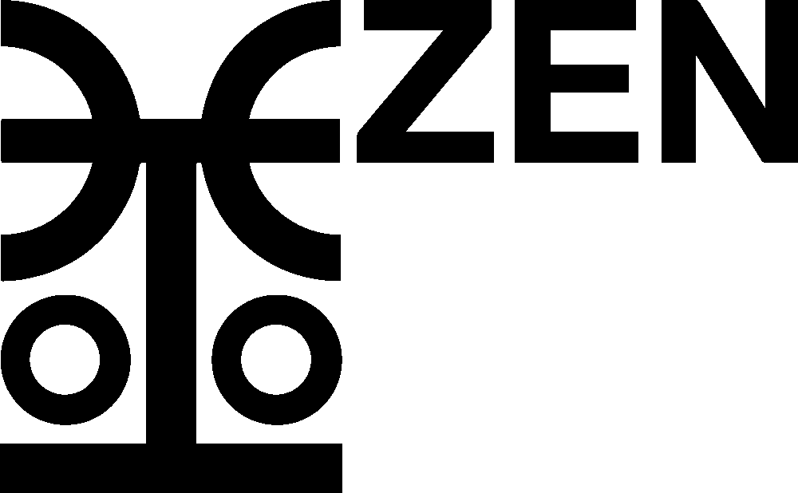
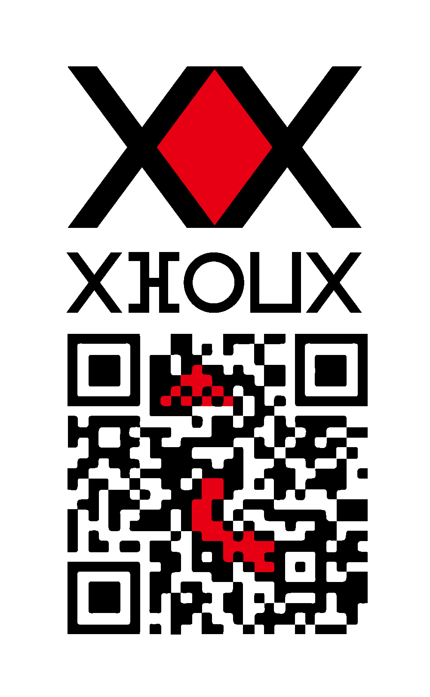

# Zen: Money You Can Hold and Send

<p align="center">
  
</p>

Zen (from the Arabic *Mizan*, "the balance": ⵣⴻⵏ, 全, الميزان) is an open-source monetary system tied to metal. It has three physical coins of gold, silver and copper, and three electronic coins on three public chains. The metal coins are the reference. Every block of payments is checked by one small proof of 196 bytes.

> Zen is still in research and development. It runs only as a test network: the test coins have no value, and the code is not audited. Ideas, questions and criticism are welcome.

**New here?** Pick your path:

| You want to... | Go to |
|---|---|
| Run the test network on your machine in 10 minutes | [Quick start](#quick-start) below |
| Run every test, simulation and demo | [`docs/TESTING.md`](docs/TESTING.md) |
| Review the code or the design (human) | [`REVIEWING.md`](REVIEWING.md) |
| Review the code or the design (AI assistant or agent) | [`AGENTS.md`](AGENTS.md) |
| Understand the words (blow, stamp, seal, S...) | [`docs/GLOSSARY.md`](docs/GLOSSARY.md) |
| See what is known to be wrong or unfinished | [`docs/KNOWN-ISSUES.md`](docs/KNOWN-ISSUES.md) |
| Read the design | [`whitepaper/Zen-white-paper-draft-0.4.pdf`](whitepaper/Zen-white-paper-draft-0.4.pdf) |

## Watch and read

<p align="center">
  <a href="https://www.youtube.com/watch?v=c3Mrpw75twc"></a>
</p>

- **Video series:** [Episode 1, A Short History of Trust](https://www.youtube.com/watch?v=c3Mrpw75twc) on YouTube
- **Blog** (Tor Browser needed): http://wmjtj25a6x3u2bzp44iei76gfprmmllm6kvd4ocr7qwsmnwkqrey3qad.onion/

## Six coins, one reference

| Physical coin | Metal | Use | Electronic twin | Block time |
|---|---|---|---|---|
| **Ren** | 4 g of gold | savings and large settlements | **Golden Yen** (1 Yen = 1 Ren, the aim) | 15 min, limited supply |
| **Ten** | 3 g of silver | salaries and trade | **Silver Ken** (1 Ken = 1 Ten, the aim) | 5 min |
| **Sen** | 2 g of copper | everyday purchases and small change | **Bronze Jen** (1 Jen = 1 Sen, the aim) | 2.5 min, launches first |

Each electronic coin aims to match its physical coin one to one, with no custodian and no price feed in between. Amounts are counted in base twelve, which divides evenly by 2, 3, 4 and 6.

## Three layers

1. **Physical coins (Ren, Ten, Sen):** 3D-printable designs, so anyone with a metal printer and their own metal can make coins. Checking a coin by hand (weight, size, sound) and making coins hard to counterfeit are open research.
2. **Electronic coins (Yen, Ken, Jen):** three linked chains that watch each other, with a built-in exchange and atomic swaps between them.
3. **Streaming (Y-, K-, J-Network, together the Z-Network):** payment channels and channel factories. You melt coins into a channel, stream payments off the chain, and cast the final balance back. Coin points connect the coin in your hand to its twin in the network.

## Quick start

You need Linux or macOS, [Rust](https://rustup.rs) (stable, 1.85 or newer) and about 2 GB of free disk. Nothing here touches real money or the internet: three chains run on your own machine.

```bash
git clone <this repository> zen && cd zen/L2-cryptocurrencies/node

export RUSTC_BOOTSTRAP=1                 # plonky2 uses nightly features; this lets stable Rust build it
cargo build --release                    # 2 to 10 minutes

Z=target/release/zenproof
$Z net init all /tmp/zen-net             # test keys and network files (no value)
$Z node serve-all /tmp/zen-net           # Yen, Ken and Jen in one process; leave it running
```

In a second terminal, from the same folder:

```bash
Z=target/release/zenproof; W=/tmp/zen-net/wallets
for p in 18450 18451 18452; do $Z node mine 127.0.0.1:$p 3; done      # mine 3 blocks on each chain
A=$($Z wallet address $W/w1.key)
$Z wallet pay $W/w0.key 127.0.0.1:18442 $A 1000000                    # pay on Jen
$Z node mine 127.0.0.1:18452 2
$Z wallet balance $W/w1.key 127.0.0.1:18442
```

Expected last line: `zen1... | balance 10001000000 base units | ...`. The block explorers are at http://127.0.0.1:18460/ (Yen), http://127.0.0.1:18461/ (Ken) and http://127.0.0.1:18462/ (Jen).

The full guide, with the test suite, the live demos, Docker and real proofs, is [`L2-cryptocurrencies/node/README.md`](L2-cryptocurrencies/node/README.md).

## What is in this repository

Every folder has its own README that says what the part is, how to run it and what to expect.

| Folder | Contents | Run it |
|---|---|---|
| [`L1-physical-coins`](L1-physical-coins) | Layer 1: specifications, images and 3D models (STL, IGES) of Ren, Ten and Sen | open the models in any 3D viewer or slicer |
| [`L2-cryptocurrencies/node`](L2-cryptocurrencies/node) | Layer 2: the reference node, wallet, three-chain test network and proof circuits (Rust) | `cargo build --release`, `cargo test --release` |
| [`L2-cryptocurrencies/groth16-wrap`](L2-cryptocurrencies/groth16-wrap) | the last proof step: the Plonky2 proof wrapped into a 196-byte Groth16 proof (Go, gnark) | optional, heavy: see its README |
| [`L2-cryptocurrencies/benchmarks`](L2-cryptocurrencies/benchmarks) | the six proof-system benchmarks that led to the current design (Rust) | `cargo build --release` in each |
| [`L2-cryptocurrencies/prototypes`](L2-cryptocurrencies/prototypes) | the first Go prototypes of collaborative minting, and the supply simulation | see its README |
| [`L3-channel-factories`](L3-channel-factories) | Layer 3: notes on channels and factories, and where they are implemented in the node | live demo scripts |
| [`simulations`](simulations) | the Python and JavaScript models behind the rules | `python3 file.py`, `node file.js` |
| [`whitepaper`](whitepaper) | the white paper, [draft 0.4 (PDF)](whitepaper/Zen-white-paper-draft-0.4.pdf), and its LaTeX sources | `pdflatex zen-whitepaper.tex` |
| [`data-minting`](data-minting) | an early data-minting prototype (2020) | `python3 mint.py` |
| [`docs`](docs) | the project page, and the guides for testers and reviewers | |

Coming from the old repository layout? [`docs/FILE-MAP.md`](docs/FILE-MAP.md) lists where every file went.

## Where the work stands

**Built and tested**
- A Rust node, wallet and three-chain test network that run on one laptop, with a wallet page in the browser.
- Payments, payment channels, channel factories, vaults, orders and auctions.
- One 196-byte proof per block covering payments and all of these operations (Plonky2, wrapped in Groth16). A node checks it in a few milliseconds.
- 583 rule-breaking tests that try to make the proof circuits accept something the node refuses. None succeeds.
- 139 automated tests pass. The code was written with AI assistance and is tested in the open.

**Needed next**
- A public multi-party ceremony to create the proof key. Today's key was made on one machine and is for testing only.
- An independent audit of the circuits and the consensus rules.
- Fuzzing of every message decoder.
- A public test network that others can join.
- Speed tests of the proof builder on GPU servers, and of the wallet on phones.

The list of known defects and open questions is kept in [`docs/KNOWN-ISSUES.md`](docs/KNOWN-ISSUES.md).

## Help build it

Zen needs people who will look for what is wrong with it. An hour of careful review is worth more than praise.

- **Cryptographers:** read the proof circuits and the soundness tests, and try to break them.
- **Rust developers:** review the node, the transport and the wallet, write fuzzers, and fix what you find.
- **Ceremony participants:** take part in the public setup of the proof key. One honest participant is enough.
- **Testers:** run the test network on a Mac or Linux machine and report what fails.

[`REVIEWING.md`](REVIEWING.md) says where to start for each of these, and how to report what you find. Open an issue or a pull request to get started.

## Support the work

Donations pay for an independent audit, the public ceremony and time on build machines. This is a donation to open-source development. It is not an investment, and it gives no right to coins, tokens or returns.

- **Giveth:** https://www.giveth.io/project/zen-money-you-can-hold-and-send
- **Bitcoin:** `3Di7NCacvRmsRxxZ8Q6VDoXniVFZBrV8Pw`

<p align="center">
  
</p>

## License

The code is under the [Apache License 2.0](LICENSE).

---

Zen, by Justus L. Ludovic. This project has no connection to any meme coin or token on pump.fun or other platforms.
